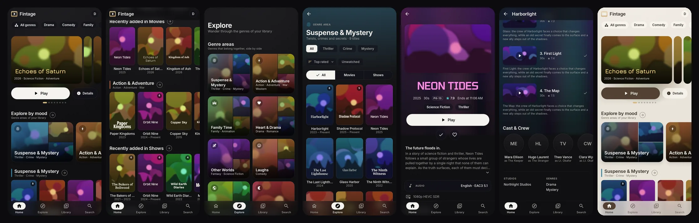

<div align="center">

# 🎞️ Fintage for Android

**A native Jellyfin app in the calm, cinematic look of Fintage, made for browsing and discovering.**

<br>



</div>

<hr>

### ✨ What it brings

- **Home made for discovering:** the genres of your library as pills right at the top, a spotlight of titles whole in cards with a soft glow in their colors, Continue Watching and Next Up, and then the genre areas of your library with a row of titles for each, between Recently Added, Because You Watched and Highly Rated
- **Genre areas:** the genres of the server grouped into places to wander through, like the aisles of a video store: Action & Adventure, Suspense & Mystery, After Midnight, Other Worlds, Laughs, Heart & Drama, Family Time, Real Stories and Music & Stage. They work with the genres of TMDB, TVDB and AniDB, in English and in German
- **Explore:** every genre area and every genre with a picture of its own, the decades, the collections and the studios
- **One kind of page for all titles:** a genre, an area, a decade, a studio, a library or your favorites, with the genres of an area as chips, sorting, Unwatched, and Movies or Shows
- **Detail pages like the theme:** the image whole in a card with a soft glow in its colors, the logo as the title, the white Play button with the gold progress, the audio and subtitle tracks as glass cards to choose from, the episodes with their images and plot, the cast, More Like This and the credits at the very end, like at the end of a film
- **Search** for movies, shows, episodes, people and collections, with your recent searches and the genres to browse while the field is empty
- **A player that plays directly whenever the phone can:** it tells the server which codecs this phone decodes, so the server converts only what it must. It also has audio and subtitle tracks, speed, zoom, double tap to skip, picture-in-picture, the next episode, and progress reports, so Continue Watching stays in sync on every device
- **Signing in** with the address of the server or a server found on your home network, with a password or Quick Connect
- **The dark theme** in ink and champagne gold with a faint film grain, and **the light theme** in sand and espresso
- built with Jetpack Compose and Material 3 for **Android 17 (API 37)**, with the frosted bars of the theme, a navigation rail on tablets and foldables, and the permission for the home network that Android 17 asks for

<hr>

### 👇 Installation

1. Download `Fintage-1.0.0.apk` to your phone.
2. Open it and allow your browser or file manager to install apps, if Android asks.
3. Sign in to your Jellyfin server. If it runs on your home network, allow Fintage to reach devices there.

It runs on Android 8 and newer, and is made for Android 17.

<hr>

### 🛠️ Building

You need JDK 17 or newer and the Android SDK with `platforms;android-37.2` and `build-tools;37.0.0`.

```sh
./gradlew assembleDebug      # app/build/outputs/apk/debug
./gradlew assembleRelease    # app/build/outputs/apk/release
```

For a release signed with your own key, put a `keystore.properties` next to `settings.gradle.kts`. It is ignored by git, so the key never ends up in the repository:

```properties
storeFile=/path/to/fintage-release.jks
storePassword=…
keyAlias=fintage
keyPassword=…
```

Without it, the release is signed with the debug key. To install an update over an installed app, Android needs the same key that signed it.

<hr>

### 🧪 Tests

```sh
./gradlew testDebugUnitTest
```

- The unit tests cover the formatting, the genre areas and the addresses of the home network.
- With a Jellyfin server at `FINTAGE_TEST_SERVER` (default `http://127.0.0.1:8096`, user `demo`, password `demo`), the tests also check the client against the real server: signing in, the feeds, the genre filters, playback decisions and progress reports. They also render every screen with Robolectric into `screenshots/`. Without a server, these tests are skipped.

<hr>

### 📁 Files

| Path | What it is |
| --- | --- |
| `app/src/main/kotlin/…/data/jellyfin/` | the Jellyfin client, its models, the device profile and the discovery of servers |
| `app/src/main/kotlin/…/data/` | the genre areas, the feeds of the pages, the images, the settings and the session |
| `app/src/main/kotlin/…/ui/theme/` | the colors, type, shapes, grain, glass and glows of Fintage |
| `app/src/main/kotlin/…/ui/` | the components, the navigation and the screens |
| `app/src/main/kotlin/…/player/` | the player |

The app uses Inter by The Inter Project Authors under the SIL Open Font License, the same font as the theme; the license comes with the app in `app/src/main/assets/licenses/`.
